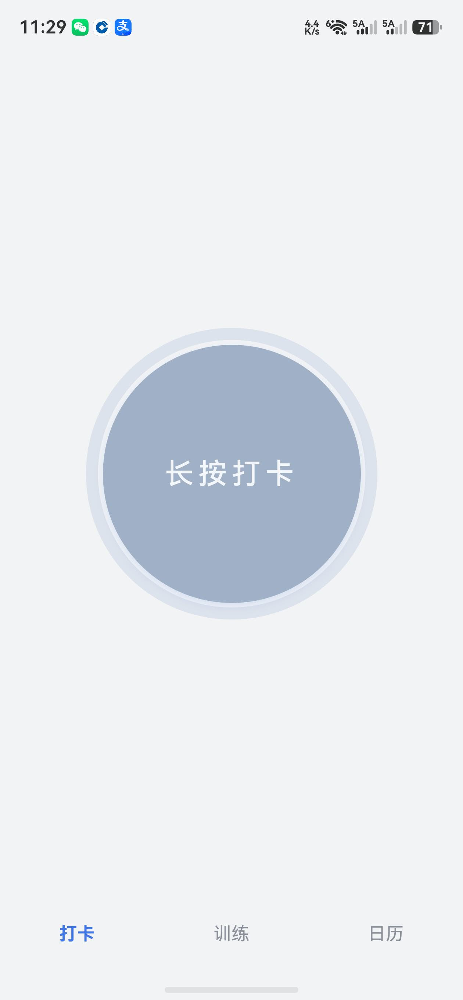
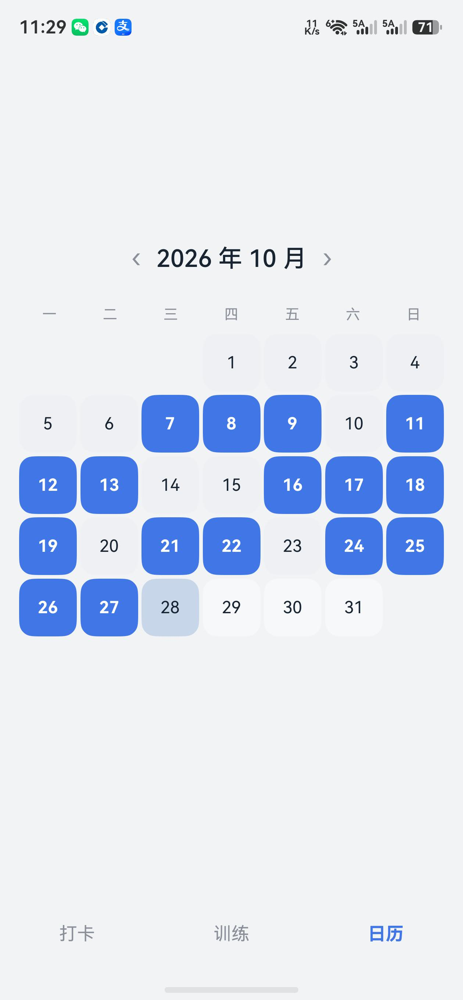
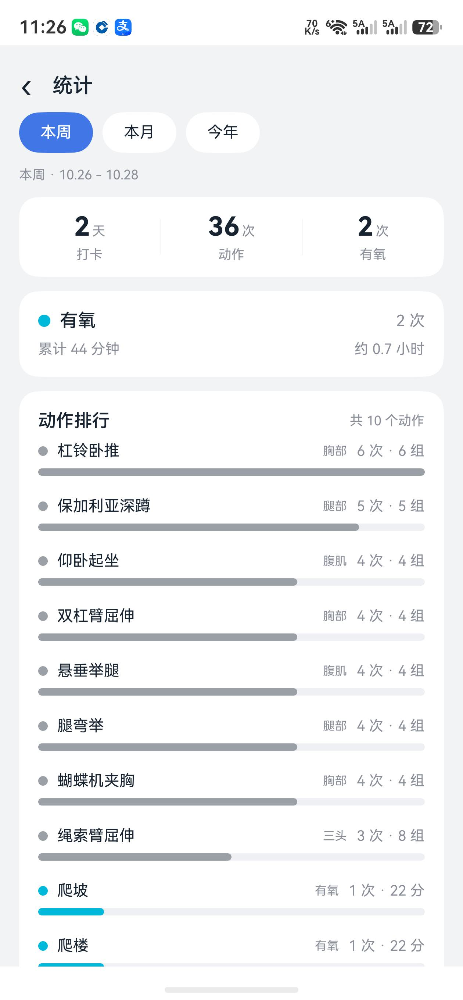
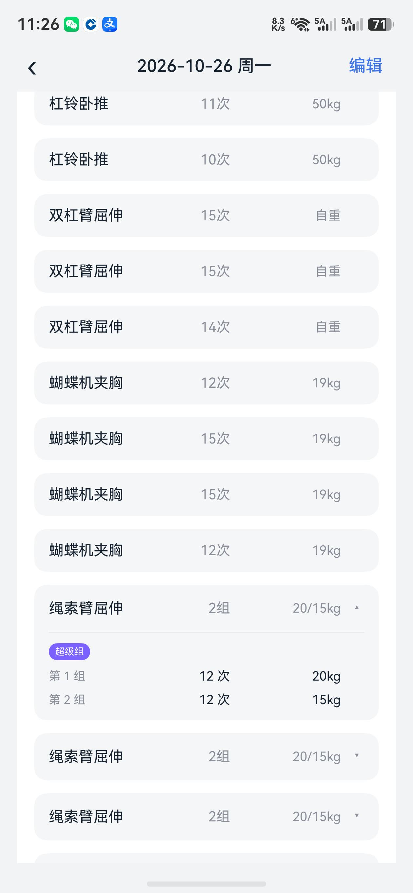

# FitDot · 健身打卡

一个跑在鸿蒙手机上的极简健身打卡 App。记录训练不用建表、不用选模板：**一键打卡，顺手记下今天练了哪些动作、几组几次几公斤。**

- 纯本地：数据存在手机里（RelationalStore / SQLite），无账号、无联网、无广告
- 一眼看清：今天打没打卡、连续多少天、这周/这月/今年练了什么
- 练得细也记得快：组数、次数、重量、自重动作、超级组、有氧时长

| 打卡 | 日历 |
| --- | --- |
|  |  |

| 统计 | 训练记录 |
| --- | --- |
|  |  |

## 功能

**打卡**
- 首页长按大圆钮即打卡，当天状态、连续天数一眼可见
- 连续天数不断签：今天还没打时从昨天往前算

**训练记录**
- 8 个部位（肩部 / 腿部 / 背部 / 二头 / 胸部 / 三头 / 腹肌 / 有氧），可多选
- 力量动作按「组」记录：每组独立的次数 × 重量
- 自重动作（引体向上、双杠臂屈伸、悬垂举腿、卧姿抬腿卷腹…）只记次数，不填重量；把负重加上后随时改回负重模式
- 超级组：连续添加即成组，默认 2 组，点开行看每组明细
- 有氧：时长 / 坡度 / 速度
- 打卡时顺手记录上次同动作的数据，方便对照

**日历**
- 月历打点，点任意一天回看或补录
- 支持切换年份看全年

**统计**（长按底部「打卡」Tab → 统计）
- 本周 / 本月 / 今年 三个区间切换
- 打卡天数、动作次数、有氧次数与累计时长
- 动作排行：这段时间练了哪些动作、各多少次、多少组

**配置管理**（长按底部「打卡」Tab → 配置管理）
- 部位与动作清单全部可增删改
- 每个动作可切换「自重 / 负重」

**数据管理**（长按底部「打卡」Tab → 数据管理）
- 导出 / 导入 JSON 备份，换机不丢数据

| 配置管理 | 统计（长按菜单进入） |
| --- | --- |
|  |  |

## 技术

- HarmonyOS 7 / API 26，Stage 模型
- ArkTS + ArkUI 声明式开发，状态管理 V2（`@ComponentV2` / `@Local` / `@ObservedV2` / `@Trace`）
- 数据：RelationalStore（SQLite）；配置：Preferences
- 导航：`Navigation` + `NavPathStack`

## 运行

需要 DevEco Studio（含 HarmonyOS SDK API 26）。

```bash
# DevEco Studio 打开工程后直接运行，或命令行构建：
hvigorw assembleHap
```

产物：`entry/build/default/outputs/default/entry-default-signed.hap`

> 仓库不包含任何签名配置（证书路径、证书口令、本机目录均未提交）。
> 首次运行前在 DevEco Studio 的 **File → Project Structure → Signing Configs** 里
> 勾选「Automatically generate signature」即可。

## 目录

```
entry/src/main/ets/
├── pages/Index.ets         主框架：底部三 Tab + 路由栈
├── view/                   页面：打卡首页 / 训练记录 / 日历 / 统计 / 配置 / 数据
├── service/                业务：打卡、统计、配置
├── repository/             数据访问（打卡记录、训练明细）
├── database/               建库建表与版本迁移
├── model/数据模型
└── common/                主题、常量、跨页状态
```
